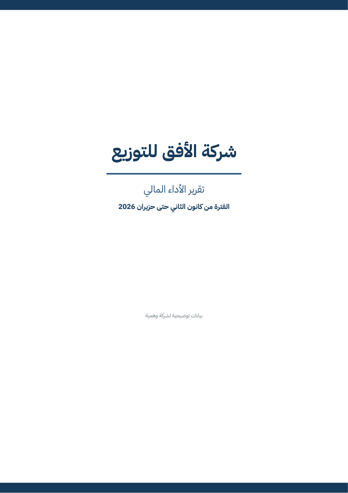
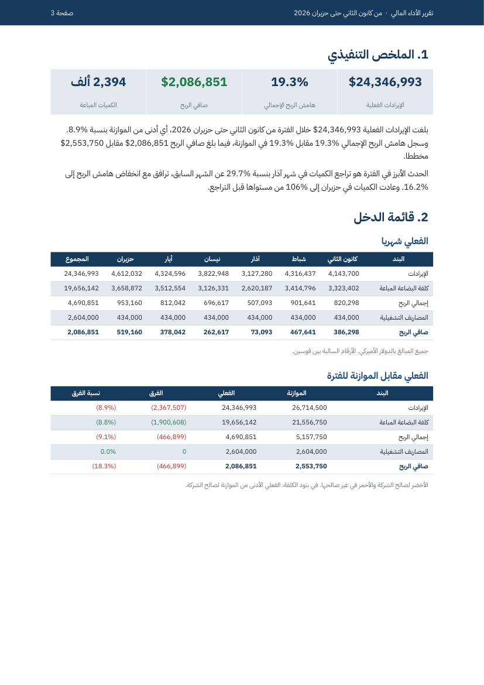
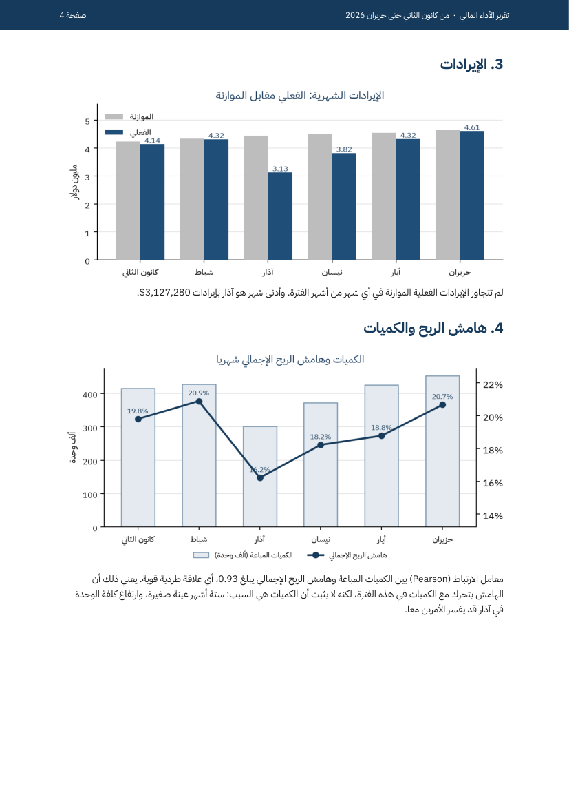

# Arabic Financial Reports: a Claude skill

A [Claude Code](https://claude.com/claude-code) / Claude Agent skill for building right-to-left **Arabic financial PDF reports** from Excel workbooks with Python (reportlab + matplotlib), plus a standalone helper module you can use without Claude.

It solves the part that usually breaks: Arabic letters coming out reversed, disconnected or blank in reportlab PDFs and matplotlib charts. It also covers the analysis side, so the report says something true about the numbers.

| Cover | Summary and tables | Charts |
|---|---|---|
|  |  |  |

*Sample output from fictional data: [sample_report.pdf](building-arabic-financial-reports/assets/sample_report.pdf)*

**Tested on real data:** [Apple Inc. quarterly results from SEC EDGAR](examples/apple-sec-edgar/), with a derived fourth quarter, no budget, and English names inside Arabic text.

## What's inside

```
building-arabic-financial-reports/
├── SKILL.md                 the skill: workflow, rendering rules, common mistakes
├── reference.md             visual spec, chapter template, Arabic writing rules
├── scripts/
│   ├── arabic_pdf.py        reusable RTL building blocks (no data, no company specifics)
│   ├── example_report.py    Excel → JSON → 5 page Arabic PDF, every sentence computed
│   ├── test_bidi.py         regression tests for symbol and Latin placement
│   └── make_sample_data.py  generates the fictional sample workbook
└── assets/
    ├── sample_company.xlsx  fictional 6 month P&L, regions, volumes
    ├── sample_report.json   extracted single source of truth
    ├── sample_report.pdf    the output
    └── fonts/               IBM Plex Sans Arabic (SIL OFL 1.1)

examples/apple-sec-edgar/    the same toolkit on real public filings
```

## The three rules that matter

1. **reportlab needs pre-shaped Arabic, matplotlib must not get it.** reportlab has no complex text layout, so every string goes through `arabic_reshaper` + `python-bidi`. matplotlib (3.11) shapes Arabic itself; pre-shaping it scrambles the letters.
2. **Use a font that covers Arabic and Latin.** Many Arabic fonts have no `$`, `%`, parentheses or Latin letters, and they vanish without an error. The bundled font covers both.
3. **Don't trust bidi with symbols.** Inside Arabic sentences python-bidi puts `%` and `$` on the wrong side of numbers, flips `10-Q` to `Q-10`, and turns a line starting with an English name left-to-right. `ar()` fixes all of these; `test_bidi.py` checks them.

`arabic_pdf.py` also handles the less obvious parts: multi-line RTL paragraphs that wrap correctly, a right-aligned clickable table of contents, RTL tables, a running header, a palette derived from one brand colour, and accounting-style negatives in parentheses.

## Install as a skill

Copy the `building-arabic-financial-reports` folder into your skills directory:

- Claude Code (personal): `~/.claude/skills/`
- Claude Code (one project): `.claude/skills/` in that project
- Claude.ai: zip the folder and upload it under Settings → Capabilities → Skills

Then ask, for example: *"Build an Arabic financial report from the workbooks in ./data"*.

## Use without Claude

```bash
pip install reportlab arabic-reshaper python-bidi matplotlib openpyxl numpy pymupdf
cd building-arabic-financial-reports
python scripts/make_sample_data.py
python scripts/example_report.py --color "#1F4E79"
python scripts/test_bidi.py
```

```python
import arabic_pdf as A

A.register_fonts()
pal = A.make_palette('#0D3B2E')
S = A.make_styles(pal)
story = [A.h1('الملخص التنفيذي', S),
         A.ArPara('بلغت الإيرادات الفعلية 24,346,993 دولار خلال الفترة.')]
A.ArabicDoc('report.pdf', header_text='تقرير الأداء المالي', palette=pal,
             cover=False).multiBuild(story)
```

## Data

All figures in the sample workbook and report belong to a made-up company and are generated by `make_sample_data.py`. No real company, person or location is represented. The [Apple example](examples/apple-sec-edgar/) uses public SEC EDGAR data and is not affiliated with Apple Inc.

## License

Code and docs: [MIT](LICENSE). Fonts: [SIL Open Font License 1.1](building-arabic-financial-reports/assets/fonts/OFL.txt).
